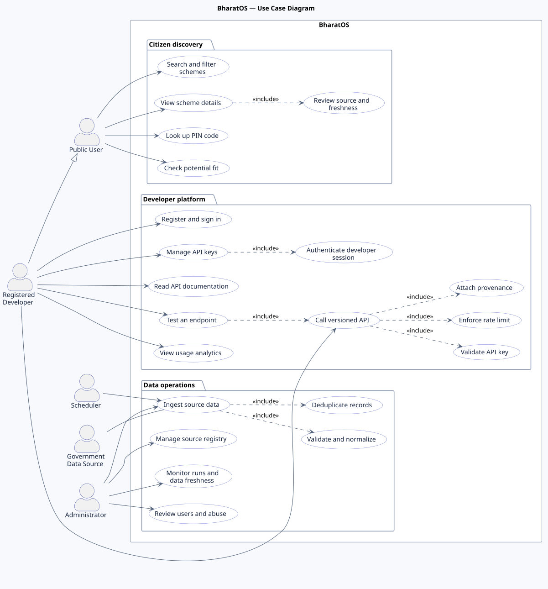
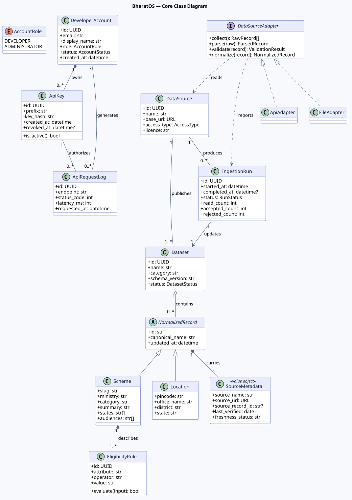
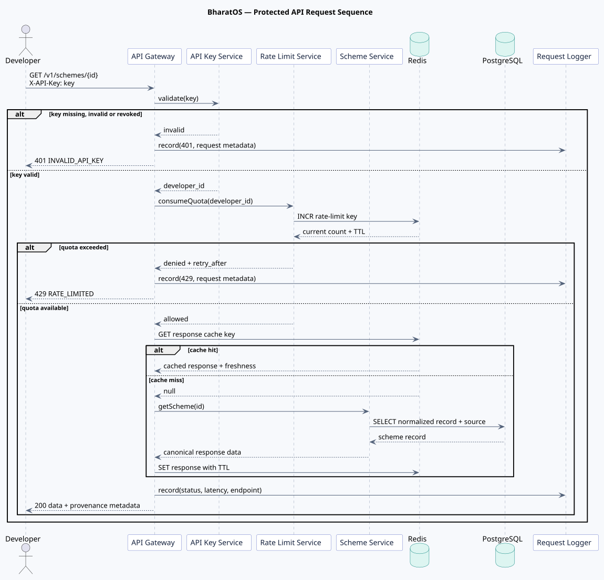
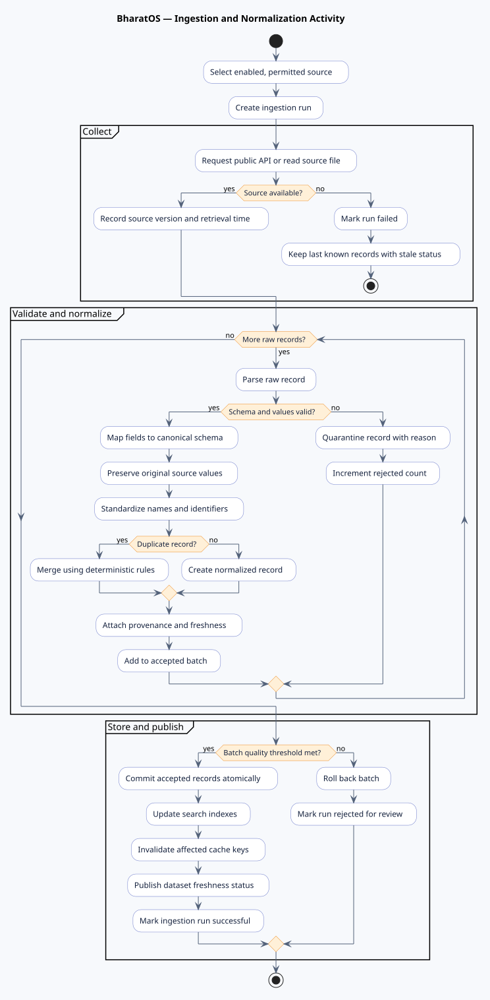
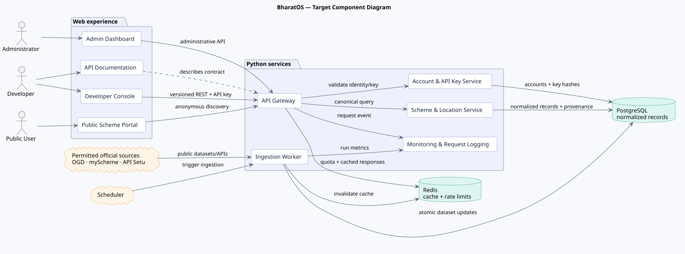

# BharatOS — Software Engineering Lab Guide

## Part 1: Simple overall explanation

### 60-second project explanation

BharatOS is a student-built portal and API for Indian public schemes and civic data. Government information is spread across portals with different formats and access methods. Citizens can search source-linked scheme snapshots without creating a profile. Developers can use versioned endpoints; in database mode they can register, create and revoke keys, and view usage. The project now also includes database-backed imports, optional Redis caching and limits, and administrator monitoring. When available, detail pages show the last administrator-run check of the exact source page, including its time; that check does not prove the data is current. The available records are still limited snapshots, not a complete live government feed. The diagrams describe the intended full system, while the table below distinguishes implemented and planned features.

### Problem, solution and value

- **Problem:** useful government data exists, but it is fragmented across departments, formats, naming conventions and access mechanisms.
- **Solution:** a thin normalization and developer-experience layer that keeps the official source visible.
- **Citizen value:** faster discovery of potentially relevant schemes without creating a profile.
- **Developer value:** one versioned response structure rather than a new integration for every source.
- **Administrative value:** one place to monitor source availability, ingestion runs, freshness and API health.
- **Important boundary:** BharatOS is not an official service and never makes a final eligibility decision.

### What each interface does

1. **Explore schemes:** searches and filters the currently loaded source-linked records by text, category, state and audience. When selected state or audience filters hide records with unspecified relevant metadata, the page reports how many may need separate review; a checkbox can include and label them. Missing metadata is not an eligibility decision. The default in-memory catalogue has eight records; database imports may add others.
2. **Scheme details:** explains the broad purpose, possible relevance, responsible ministry, source and verification date.
3. **Developer console:** uses a fixed demo key in in-memory mode. In database mode, developers register, sign in, create, rotate and revoke personal keys, view usage and call the API playground.
4. **API documentation:** `/docs` explains the contract; `/reference` and `/openapi.json` provide the generated API reference and schema.
5. **Admin view:** with a configured administrator token and database, displays recorded runs, quality indicators, usage totals, optional cache metrics and explicitly requested source-page checks. These checks do not prove dataset availability or current eligibility.
6. **PIN lookup:** allows anonymous searches over loaded location records, displays all offices in a record and highlights third-party or stale provenance. PINs may still appear in the browser URL/history; server access logs redact the query.

## Part 2: Actors and use cases

### Identified actors

| Actor | Why the actor is outside the system | Main interactions |
| --- | --- | --- |
| Public User | Uses public features without needing an account. | Search/filter schemes, view details, check potential fit and look up PIN codes. |
| Registered Developer | Is a specialized user who also has developer credentials. | Sign in, manage API keys, read docs, test/call APIs and view usage. |
| Administrator | Operates the platform. | Manage sources, trigger ingestion, monitor freshness and review abuse. |
| Government Data Source | An external system supplying permitted records. | Provides datasets or API responses to ingestion. |
| Scheduler | An external time-based trigger. | Starts scheduled ingestion runs. |

### Use Case Diagram



The diagram answers “who can ask BharatOS to do what?” The large rectangle is the system boundary. Actors remain outside it. The internal use cases are grouped into citizen discovery, developer platform and data operations.

Relationship justification:

- `Registered Developer --|> Public User` is actor generalization: a registered developer may also use public discovery features, whether or not signed in.
- “View scheme details” **includes** “Review source and freshness” because every detail response must show provenance.
- “Manage API keys” **includes** session authentication because each key operation checks the developer's session. Registering or signing in is a separate use case; a valid existing session avoids signing in again.
- In the **target design**, “Call versioned API” includes key validation, rate-limit enforcement and provenance. The current implementation enforces rate limits only when Redis is configured; the in-memory demonstration mode does not provide rate limiting.
- “Test an endpoint” **includes** “Call versioned API” because the playground uses the same public contract.
- Ingestion **includes** normalization and deduplication as distinct mandatory steps in the target pipeline.
- No `extend` relationship is used merely to decorate the diagram. Optional exceptional paths are clearer in the activity and sequence diagrams.

### Major use cases to explain verbally

- **Search and filter schemes:** anonymous query over canonical metadata.
- **View provenance:** source name, URL, last verification and freshness state are part of the result.
- **Call versioned API:** a developer supplies a key and receives a standard envelope.
- **Manage API keys:** create, rotate and revoke credentials in database mode.
- **Ingest source data:** collect only from permitted APIs/files and record the source version.
- **Monitor freshness:** detect failed runs or stale records rather than silently presenting them as current.

## Part 3: Other UML diagrams

### Class Diagram



This is the static/domain view. `NormalizedRecord` captures fields shared by data exposed through the platform. `Scheme` and `Location` inherit from it. `SourceMetadata` is composed into each normalized record because provenance must travel with the record. A scheme owns one or more `EligibilityRule` objects. A `DeveloperAccount` owns zero or more `ApiKey` objects, and keys authorize request logs. `DataSourceAdapter` is an interface implemented by API/file adapters.

Key multiplicities:

- One developer account owns `0..*` keys; a new account may have none, while active developers may rotate several.
- One key can authorize `0..*` requests; each logged protected request refers to one key.
- One dataset contains `0..*` normalized records; an empty new dataset is valid before its first successful run.
- One data source publishes `1..*` datasets and produces `0..*` ingestion runs.
- One scheme composes `1..*` eligibility rules; deleting the scheme removes those scheme-specific rules.

### Sequence Diagram



This is the **target** runtime/time-ordered view for a protected API request. The gateway validates the key and checks quota before using a cache or the data service. The `alt` fragments show invalid-key, rate-limit, cache-hit and cache-miss paths. In the current database mode, key validation and the cache revision check still query the database on a cache hit; the cache avoids loading the full scheme catalogue, not every database access. PIN lookups use the database directly. Redis and limits are optional in local development.

### Activity Diagram



This is the **target** control-flow view of ingestion. It has an initial node and terminal paths for collection, validation, quarantine, deduplication and publication. Today, the importer validates the whole batch, deduplicates identical identifiers, rejects conflicting duplicates, rolls back invalid batches and marks affected prior records `review_due`. A persistent quarantine workflow and configurable batch-quality thresholds remain planned.

### Component Diagram



This is the high-level architecture view. Browser experiences depend on the API gateway. The gateway delegates identity, canonical data access, cache/rate limits and logging. Ingestion is separate from live request serving, so a failed source refresh does not directly break the API. PostgreSQL owns durable normalized data, while Redis owns disposable cache and rate-limit state.

### Why multiple diagrams are necessary

- Use case: requirements and actor responsibilities.
- Class: domain structure and data relationships.
- Sequence: order of interactions for one request.
- Activity: branching process logic for ingestion.
- Component: system modules and technical dependencies.

No single diagram can accurately represent all five concerns without becoming unreadable.

## Part 4: Technical explanation

### Original Phase 1 architecture

- FastAPI receives page and API requests.
- Jinja renders accessible server-side pages.
- Pydantic validates scheme, location, source and response-envelope data.
- Python lists provide eight scheme snapshots and three PIN-code records.
- A FastAPI dependency checks the fixed prototype `X-API-Key`.
- Search filters run in memory and do not save request profiles.
- Minimal browser JavaScript controls navigation, key copying and the API playground.
- Pytest/TestClient verify page routes and API behaviour.

### Current implementation beyond Phase 1

- Setting `DATABASE_URL` switches scheme and PIN reads to SQLite or PostgreSQL; Alembic manages the schema.
- The ingestion pipeline stores source attribution, tracks runs, rejects invalid batches and advances a cache revision. A dated PIB scheme subset is available; a PIN CSV adapter and optional scheduler require an independently verified local file.
- Database-backed filters use stored scheme metadata indexes for category, state and audience. Free-text substring search currently uses SQL `LIKE`; it is not yet a full-text search engine and individual searches are not saved by the index.
- Database mode provides developer accounts, hashed keys, rotation/revocation, expiring sessions and request logs. The fixed demo key works only without a configured database.
- Configured Redis provides scheme-catalogue caching and fixed-window request limits. PIN lookups query the database directly. Without Redis, these features are disabled.
- The protected administrator view shows recorded runs, freshness and quality indicators, cache counters, alerts and manually triggered HEAD checks of fixed official pages.
- A local Compose stack, optional localhost HTTPS, backup/restore tooling and measured prototype/service benchmarks are available. Public deployment and a developer pilot have not been completed.

### Target architecture

1. **Ingestion:** a source-specific adapter reads a permitted public API or file.
2. **Validation:** required fields, types and source constraints are checked.
3. **Normalization:** source-specific names become canonical fields while originals remain traceable.
4. **Deduplication:** deterministic keys prevent the same civic entity being served twice.
5. **Provenance enrichment:** source, retrieval time, update time and freshness status are attached.
6. **Storage:** a successful batch is committed atomically to PostgreSQL.
7. **Serving:** the gateway validates the key and rate limit, checks Redis and queries the service on a miss.
8. **Feedback:** request and ingestion metrics feed developer/admin dashboards.

### Standard API contract

Successful responses use:

```json
{
  "data": {},
  "meta": {
    "api_version": "v1",
    "environment": "prototype",
    "source": "Publisher or source set",
    "last_verified": "2026-09-09",
    "generated_at": "ISO-8601 timestamp",
    "result_count": 1
  }
}
```

Errors use:

```json
{
  "error": {
    "code": "INVALID_API_KEY",
    "message": "Human-readable explanation",
    "request_id": "Traceable identifier"
  }
}
```

The envelope lets clients handle success, metadata and errors consistently across datasets. `/v1` protects existing clients when a future incompatible schema requires `/v2`.

### Why Python-first

The proposal initially suggested a Next.js/Node.js implementation. Phase 1 uses FastAPI, Jinja and Pydantic instead because the same language can serve the portal, API, validation, ingestion adapters, tests and future data processing. Server-rendered templates reduce frontend build complexity, while small JavaScript modules preserve interactive quality. The architectural boundaries and REST contract remain independent of the implementation language.

### Why PostgreSQL and Redis are useful

- PostgreSQL provides transactions, constraints, indexing, relational modelling and JSON fields for heterogeneous source metadata.
- Redis is appropriate for temporary cached responses and atomic rate-limit counters.
- Keeping Redis disposable prevents cache state from becoming the source of truth.
- Both are now supported in the local Compose stack. The original in-memory mode remains available for a quick demonstration.

### Security, privacy and legal boundaries

- Production API keys must be random, shown once and stored only as secure hashes.
- HTTPS is required outside localhost.
- Rate limits protect availability but do not replace authentication or authorization.
- Citizen search remains anonymous; BharatOS does not need identity numbers to suggest broad scheme categories.
- Uvicorn access logs redact client addresses, query strings and dynamic paths. Browser history and external proxy logs are separate and need their own privacy controls.
- Aadhaar, PAN, driving-licence verification and restricted databases are explicitly outside scope.
- Only permitted public/open sources may be ingested.
- Source ownership and licence must be recorded per dataset.
- Cached stale records must be labelled stale; the system must never silently claim that old data is current.

## Part 5: Current versus planned functionality

| Capability | Current status | Remaining work |
| --- | --- | --- |
| Scheme discovery and details | Eight in-memory snapshots and 29 schemes in a freshly seeded local database, including records from six sectors covered by the dated PIB imports | Broader, permitted official datasets and improved discovery |
| Versioned API and standard envelope | In-memory or database-backed local endpoints | Expand dataset coverage and production hardening |
| Developer access | Database mode supports accounts, expiring sessions and hashed, rotatable/revocable keys | Account recovery, security review and production controls |
| PIN-code lookup | Three demonstration records; CSV adapter, checked local-file scheduler and an optional historical mirror tested with 19,300 PINs | A verified official full dataset import |
| Developer analytics | Persisted authenticated-request totals in database mode | Further analysis and operational evaluation |
| Admin monitoring | Token-protected recorded runs, freshness, quality, cache metrics, dashboard alerts and on-demand HEAD checks | Notification delivery, history and richer operations |
| PostgreSQL and Redis | Supported and tested with local Compose services | Ongoing security and operational review |
| Scheduled ingestion | Optional scheduler checks one operator-approved local PIN snapshot | Wider source scheduling and independently verified inputs |
| Performance results | Local in-memory and PostgreSQL/Redis concurrency runs recorded | Repeated tests with larger datasets and a real developer pilot |
| Deployment | Local Compose, optional localhost HTTPS and backup/restore drill | Public deployment, public certificates, security and operational ownership |

## Part 6: Five-minute lab demonstration

1. **0:00–0:40 — Problem and boundary:** state the fragmentation problem, hybrid citizen/developer goal and student-project disclaimer.
2. **0:40–1:30 — Citizen flow:** search “health,” apply an audience filter, open a result and point out source/freshness and the non-eligibility warning.
3. **1:30–2:30 — Developer flow:** in default mode use the demo key; in database mode sign in and create a personal key. Run the scheme list and, if the demonstration records were seeded, PIN `147004`; show the envelope.
4. **2:30–3:05 — Error behaviour:** explain or demonstrate that a missing key returns a standard `401` error.
5. **3:05–3:40 — Admin boundary:** if configured, load the dashboard with the administrator token; distinguish recorded import results and optional HEAD checks from a live guarantee of dataset availability.
6. **3:40–4:45 — UML:** use the use case diagram for requirements, sequence for live requests and activity for ingestion; mention what class/component diagrams add.
7. **4:45–5:00 — Roadmap:** identify the verified official PIN import, wider source coverage, production security and developer pilot as remaining work.

## Part 7: Likely viva questions and answers

### 1. What is the primary goal of BharatOS?

**Short:** To reduce the effort required to discover and integrate permitted Indian public schemes and civic data.

**Technical:** It creates a canonical domain model and versioned REST contract above source-specific adapters while preserving provenance and freshness.

### 2. Is BharatOS replacing government portals?

No. Official publishers remain the authority and application destination. BharatOS is a discovery and normalization layer that links back to them.

### 3. Why are citizens anonymous?

Broad discovery needs category, state and audience filters, not a stored identity profile. This minimizes personal-data risk and keeps Phase 1 within course scope.

### 4. Why is “potential fit” different from eligibility?

Eligibility may depend on detailed rules, documents, official databases and changing policy. The system can narrow discovery but should not claim an authoritative decision.

### 5. Why use a Use Case Diagram?

It establishes the system boundary, identifies external actors and connects each actor to functional requirements without describing implementation details.

### 6. What is the difference between `include` and `extend`?

`include` means the included behaviour is a required reusable part of the base use case. `extend` means optional or conditional behaviour adds to a complete base use case. This diagram uses `include` only where the child behaviour always occurs.

### 7. Why is Registered Developer a specialization of Public User?

A developer can perform all anonymous discovery actions and has additional authenticated developer capabilities. The hollow-triangle generalization points to the more general actor.

### 8. Why use composition for source metadata?

Provenance is inseparable from the normalized record exposed by BharatOS. A record without source/freshness metadata violates the API contract.

### 9. Why use an adapter interface?

Every source has different formats and access mechanisms. Adapters isolate those differences behind `collect`, `parse`, `validate` and `normalize`, so adding a source does not rewrite the API layer.

### 10. Why separate ingestion from request serving?

Ingestion is scheduled and failure-prone; serving is latency-sensitive. Decoupling allows the API to continue with explicitly stale last-known data when a source is temporarily unavailable.

### 11. Why are API endpoints versioned?

Versioning prevents an incompatible schema change from silently breaking existing developer applications. Additive compatible changes can remain in `v1`; breaking changes require `v2`.

### 12. Why have a standard response envelope?

Clients always know where to find data, provenance, version, timestamps and machine-readable errors, regardless of the dataset.

### 13. Why hash API keys?

Like passwords, raw keys should not be recoverable from the database. The server hashes the presented key and compares it with the stored hash. Phase 1's visible fixed key is only a demonstration.

### 14. What is the role of Redis?

Redis holds short-lived response cache entries and atomic rate-limit counters. PostgreSQL remains the durable source of truth.

### 15. How is stale data handled?

The ingestion run records source and retrieval timestamps. If refresh fails, last-known data may remain available only with an explicit stale status; it must not be presented as current.

### 16. How do you avoid duplicate records?

Use deterministic matching keys and source-specific reconciliation rules, retain original identifiers and record merge decisions. Ambiguous records should be quarantined instead of guessed.

### 17. What testing is present now?

Unit and integration tests cover validation, filtering, page and API routes, key lifecycle, ingestion, migrations, monitoring and caching. PostgreSQL and Redis service tests are also available; see the evaluation notes for actual runs.

### 18. How has performance been evaluated?

Local tests at 10, 50, 100 and 500 concurrent requests recorded p95 latency, error rate and provenance coverage for both prototype and PostgreSQL/Redis configurations. These were short local runs, not production capacity claims. See `docs/evaluation/README.md`; the developer pilot remains outstanding.

### 19. Why FastAPI and Jinja?

FastAPI provides typed request handling and OpenAPI-compatible models; Pydantic validates contracts; Jinja provides a lightweight, accessible server-rendered interface. Most of the stack remains Python without sacrificing a polished browser experience.

### 20. What is the most important project risk?

Trust. Incorrect, stale or unauthorized data could harm users. The design therefore treats permissions, validation, provenance, freshness and honest failure states as core requirements rather than optional metadata.

## Final points to remember in the lab

- Say **prototype snapshot**, not live government integration.
- Say **potentially relevant**, not eligible.
- Point to the source and verification date on the interface.
- Explain that the UML models the complete target system and the phase table identifies current implementation.
- Distinguish the implemented local PostgreSQL/Redis and monitoring features from production-ready deployment, and cite only measured evaluation results.
